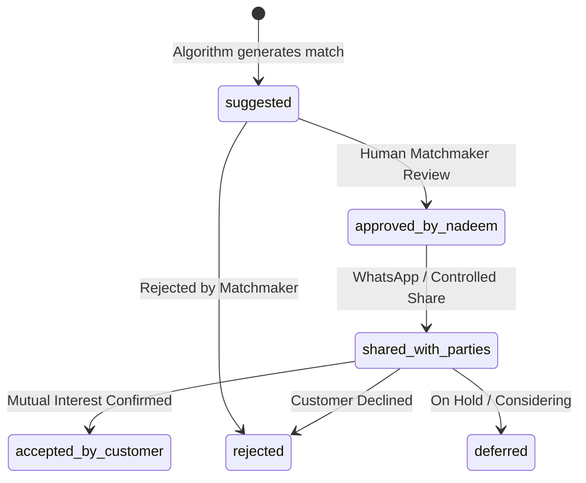

# 10. Frontend Domain Inventory for Backend Mapping

**Status:** Authoritative Engineering Inventory  
**Generated Under:** Task `T-001`  
**Inspected Baseline:** Frontend React 19 + TypeScript + Vite Source (`frontend/src/`)  
**Baseline Date:** 2026-10-24  

---

## 1. Executive Summary & Purpose

This document provides a rigorous, ground-truth inventory of all client-side domain models, data structures, repeating entity groups, business logic calculations, and UI contracts implemented in the Gulistan Marriage Bureau frontend.

### Primary Rule of Interpretation
> **UI Shapes and Prototype Behaviors Are Evidence of Domain Needs, Not Trusted Backend Implementations.**  
> The client currently runs on local React state, mocked fixture data (`frontend/src/data/mockData.ts`), and client-side role toggling. The durable backend must treat all inbound client payloads as untrusted input, enforce server-side validation and Row-Level Security (RLS), and never delegate authorization, matching verification, or financial ledger integrity to browser code.

No final database schema or business rules are silently invented here. Wherever business logic or data invariants are underspecified or subject to owner preference, this inventory explicitly cross-references the open decision records in [`09-open-decisions.md`](09-open-decisions.md).

---

## 2. Frontend Tooling & Runtime Environment Baseline

Inspected directly from [`frontend/package.json`](file:///d:/gulistan-marriage-bureau/frontend/package.json), [`frontend/tsconfig.json`](file:///d:/gulistan-marriage-bureau/frontend/tsconfig.json), and [`frontend/vite.config.ts`](file:///d:/gulistan-marriage-bureau/frontend/vite.config.ts):

* **Runtime & Framework:** React `^19.0.1` (`react`, `react-dom`), Node.js ES Modules (`"type": "module"`).
* **Build Tool:** Vite `^8.3.0` (`@vitejs/plugin-react` `^6.1.1`).
* **Styling Engine:** Tailwind CSS `^4.3.3` with `@tailwindcss/vite` `^4.3.3`.
* **Icons & UI Primitives:** `lucide-react` `^0.546.0`, `motion` `^12.23.24`.
* **Type Checking:** TypeScript `^7.0.2` targeting `ES2022`, bundled with types for React 19 (`@types/react` `^19.3.0`, `@types/react-dom` `^19.3.0`).
* **Test Runner:** Native Node.js test runner (`node:test` + `node:assert/strict`) executed with `tsx` (`^4.21.0`).
* **AI Integration:** `@google/genai` `^2.4.0` (Client-side mock/utility capability; server-side execution required for production per ADR-004).

---

## 3. Detailed Domain Model Inventory

### 3.1 Candidate Profile Entity (`ProfileRecord`)

* **Source Paths:**
  * Type definition: [`frontend/src/types/index.ts`](file:///d:/gulistan-marriage-bureau/frontend/src/types/index.ts#L57-L111)
  * Multi-step wizard UI: [`frontend/src/features/matchmaker/ProfileWizard.tsx`](file:///d:/gulistan-marriage-bureau/frontend/src/features/matchmaker/ProfileWizard.tsx)
  * Display components: [`frontend/src/components/ui/ProfileCard.tsx`](file:///d:/gulistan-marriage-bureau/frontend/src/components/ui/ProfileCard.tsx)
  * Synthetic fixtures: [`frontend/src/data/mockData.ts`](file:///d:/gulistan-marriage-bureau/frontend/src/data/mockData.ts#L3-L270)

#### Fields & Types
| Field Name | Frontend Type | UI Constraints / Format | Durable Backend Concept | Privacy Sensitivity |
| :--- | :--- | :--- | :--- | :--- |
| `id` | `string` | e.g. `'GLS-401'`, `'GLS-101'` | Primary Key (UUID or branded sequential ID) | Public reference |
| `fullName` | `string` | Full legal / family name | `candidates.full_name` | Highly Confidential (staff only) |
| `displayName` | `string` | Alias e.g. `'Dr. Fatima (Physician)'` | Masked public alias for client cards | Non-sensitive |
| `gender` | `'male' \| 'female'` | Select toggle | Normalized ENUM | Semi-public |
| `age` | `number` | Integer (derived or entered) | Stored as integer or derived from DOB | Semi-public |
| `dob` | `string` (optional) | ISO Date string (`YYYY-MM-DD`) | `DATE` column | Highly Confidential |
| `height` | `string` | Format: `5'4"`, `5'10"`, `6'0"` | Normalized total inches or cm in backend | Semi-public |
| `maritalStatus` | `MaritalStatus` | `'never_married' \| 'divorced' \| 'widowed' \| 'khula'` | Normalized ENUM | Sensitive |
| `religion` | `string` | Default: `'Islam'` | Reference table / ENUM | Sensitive |
| `aqeedah` | `string` | e.g. `'Sunni / Hanafi'`, `'Shia'`, `'Ahle Hadith'` | Normalized sectarian reference | Highly Sensitive |
| `caste` | `string` | e.g. `'Sheikh'`, `'Rajput'`, `'Arain'`, `'Jat'` | Normalized clan/biradari reference | Culturally Sensitive |
| `subCaste` | `string` (optional) | e.g. `'Qureshi'`, `'Janjoa'` | Sub-clan string | Culturally Sensitive |
| `education` | `string` | e.g. `'MBBS'`, `'Masters'`, `'Graduation'` | Standard education level tier | Non-sensitive |
| `educationField` | `string` | e.g. `'Medicine & Surgery'`, `'Computer Science'` | Free-text / field taxonomy | Non-sensitive |
| `occupation` | `string` | High-level role: `'Doctor'`, `'Engineer'` | Standard occupation taxonomy | Non-sensitive |
| `jobTitle` | `string` | e.g. `'Resident Medical Officer'` | Specific employment role | Semi-sensitive |
| `companyOrSector` | `string` (optional) | e.g. `'Services Hospital Lahore'` | Organization / employer name | Highly Sensitive |
| `monthlyIncomePKR` | `number` (optional) | Integer PKR (e.g. `240000`) | `NUMERIC` / `BIGINT` | Strictly Confidential |
| `hometown` | `string` | Origin city (e.g. `'Sialkot'`) | Normalized city reference | Semi-sensitive |
| `currentCity` | `string` | Current residence city (e.g. `'Lahore'`) | Normalized city reference | Semi-sensitive |
| `residenceArea` | `string` | Locality (e.g. `'DHA Phase 5'`, `'Gulberg'`) | Detailed geographic area | Highly Sensitive |
| `photoUrl` | `string` | URL to image asset | Private Storage object key (signed URL) | Strictly Confidential |
| `photoPermissionGranted` | `boolean` | Candidate authorization flag | Explicit consent record with timestamp | Security / Legal Gate |
| `specialQualities` | `string` (optional) | Religious/personal attributes (e.g. `'Hafiz'`) | Narrative text | Semi-sensitive |
| `hobbies` | `string[]` (optional) | Array of strings | Array / tag junction | Non-sensitive |
| `status` | `ProfileStatus` | `'pending_review' \| 'approved' \| 'active' \| ...` | Lifecycle state machine column | Operational |
| `source` | `string` | `'direct_web' \| 'walk_in' \| 'external_matchmaker'` | Source attribution tracking | Operational |
| `assignedMatchmakerId`| `string` (optional) | e.g. `'nadeem'` | Foreign key to `staff_profiles` | Operational |
| `contactPerson` | `string` | Parent/guardian name (e.g. `'Tariq Mehmood'`) | Representative name | Strictly Confidential |
| `contactPhone` | `string` | E.164 phone string (e.g. `'+92 300 4589214'`) | Normalized phone string | Strictly Confidential |
| `contactEmail` | `string` (optional) | Valid email | Normalized email | Strictly Confidential |
| `preferredContactMethod`| `'whatsapp' \| 'phone' \| 'email'` | Preferred channel | ENUM | Operational |
| `createdAt` / `updatedAt`| `string` | ISO Timestamp | `TIMESTAMPTZ` server defaults | System Audit |
| `internalNotes` | `string` (optional) | Staff commentary | Internal staff journal | Staff Only (Hidden from Customer) |

---

### 3.2 Sibling Repeating Structure (`SiblingRecord`)

* **Source Paths:**
  * Type definition: [`frontend/src/types/index.ts`](file:///d:/gulistan-marriage-bureau/frontend/src/types/index.ts#L14-L23)
  * Dynamic form inputs: [`frontend/src/features/matchmaker/ProfileWizard.tsx`](file:///d:/gulistan-marriage-bureau/frontend/src/features/matchmaker/ProfileWizard.tsx#L400-L510)
* **Shape & Multiplicity:** 1-to-many child relation to Candidate Profile (`candidate_siblings`).

| Field Name | Frontend Type | Invariants / Allowed Values | Backend Mapping & Normalization Needs |
| :--- | :--- | :--- | :--- |
| `id` | `string` | e.g. `'sib-1'`, generated client UUID | Synthetic primary key (UUID) |
| `relation` | `'brother' \| 'sister'` | Binary sibling gender relation | ENUM (`brother`, `sister`) |
| `name` | `string` (optional) | Full name of sibling | String (optional for privacy) |
| `age` | `number` (optional) | Positive integer | Integer check constraint (`age > 0`) |
| `maritalStatus` | `MaritalStatus \| 'married'` | `'married' \| 'never_married' \| 'divorced' \| 'widowed' \| 'khula'` | Sibling marital state enum |
| `occupation` | `string` (optional) | e.g. `'Software Architect'`, `'Student'` | String |
| `marriageDetails` | `string` (optional) | e.g. `'Married into Brig. Saeed family'` | Culturally significant marriage tie details |
| `childrenCount` | `number` (optional) | Integer `>= 0` | Integer check constraint |

**Backend Architectural Requirement:** In SQL/PostgreSQL, siblings must not be compressed into an unqueryable loose JSON blob. They represent a relational 1-to-many table (`candidate_siblings`) to support queryable verification and structured masking.

---

### 3.3 Property Details & Pakistani Land Measurement (`PropertyDetails`)

* **Source Paths:**
  * Type definition: [`frontend/src/types/index.ts`](file:///d:/gulistan-marriage-bureau/frontend/src/types/index.ts#L25-L36)
  * Conversion logic: [`frontend/src/utils/units.ts`](file:///d:/gulistan-marriage-bureau/frontend/src/utils/units.ts)
  * Unit tests: [`frontend/src/utils/logic.test.ts`](file:///d:/gulistan-marriage-bureau/frontend/src/utils/logic.test.ts#L8-L30)
  * Admin conventions: [`frontend/src/features/admin/AdminPortal.tsx`](file:///d:/gulistan-marriage-bureau/frontend/src/features/admin/AdminPortal.tsx#L60-L64)

#### Field Inventory
* `ownership`: `'owned' | 'rented' | 'family_owned' | 'other'`
* `propertyType`: `'house' | 'plot' | 'apartment' | 'commercial' | 'agricultural'`
* `areaMarlas`: `number` (canonical float/decimal unit stored)
* `areaKanalDisplay`: `string` (e.g. `'1 Kanal, 5 Marla'`, calculated presentation)
* `approxValuePKR`: `number` (approximate market valuation in Pakistani Rupees)
* `city`: `string`, `locality`: `string`
* `householdArrangement`: `'independent' | 'joint_family'`
* `homeSizeDescription`: `string` (e.g. `'Double-storey 1 Kanal house'`)

#### Land Unit Conversion Invariants & Regional Variations
The frontend implementation in [`convertMarlaToKanal()`](file:///d:/gulistan-marriage-bureau/frontend/src/utils/units.ts#L20-L62) enforces:
$$\text{Kanal} = \lfloor \frac{\text{Marlas}}{\text{MarlaPerKanal}} \rfloor, \quad \text{Remaining Marla} = \text{Marlas} \pmod{\text{MarlaPerKanal}}$$
$$\text{Sq Ft Equivalent} = \text{Marlas} \times \text{SqFtPerMarla}$$

* **Default Conventional Ratio:** 20 Marlas = 1 Kanal (Punjab, Islamabad, Sindh).
* **Regional Variation:** 18 Marlas = 1 Kanal in select KP and rural revenue records.
* **Surface Area Metric:** Standard modern urban development (e.g. DHA, Bahria) uses 225 sq ft / Marla; traditional Punjab revenue records use 272.25 sq ft / Marla.
* **Backend Invariant:** The database must store the canonical raw decimal (`area_marlas`) and the convention multiplier ID. Formatted strings (`formattedEn`, `formattedUrdu`) should be generated at the API presentation layer or derived deterministically. Cross-reference: [`OPEN-011`](09-open-decisions.md).

---

### 3.4 Partner Preferences & Multi-Tier Criteria Classification (`PartnerPreference`)

* **Source Paths:**
  * Type definition: [`frontend/src/types/index.ts`](file:///d:/gulistan-marriage-bureau/frontend/src/types/index.ts#L38-L55)
  * Classification logic: [`frontend/src/utils/matchmaker.ts`](file:///d:/gulistan-marriage-bureau/frontend/src/utils/matchmaker.ts)
  * Wizard step: [`frontend/src/features/matchmaker/ProfileWizard.tsx`](file:///d:/gulistan-marriage-bureau/frontend/src/features/matchmaker/ProfileWizard.tsx#L650-L760)

#### Invariants & Classification Enum
Preferences use a two-level structure:
1. **Target Criteria Values:**
   * Age range: `ageMin` (number), `ageMax` (number)
   * Minimum height: `heightMin` (e.g. `"5'9\""`)
   * Marital status: `maritalStatus: MaritalStatus[]` (multi-select)
   * Religious & cultural: `religion`, `aqeedah`, `caste`
   * Education: `educationMin`
   * Occupations: `preferredOccupations: string[]`
   * Cities: `cityPreferences: string[]`
   * Living arrangements: `familyArrangement: 'independent' | 'joint_family' | 'any'`
   * Career & relocation: `relocationPreference`, `workAfterMarriagePreference`
2. **Runtime Classification Dictionary (`criteriaClassifications`):**
   * Maps criteria IDs to one of 5 strict tiers:
     * `'mandatory'`: Must be satisfied; failure drops match eligibility entirely.
     * `'preferred'`: Weighted strongly in compatibility score.
     * `'acceptable_range'`: Moderate weight; flexible deviation allowed.
     * `'unknown'`: Unspecified by family; neutral weight.
     * `'not_disclosed'`: Explicitly withheld.

* **Backend Invariant:** Criteria weighting is evaluated server-side (`evaluateMatchCriteria`) with multipliers: `mandatory = 3`, `preferred = 2`, `acceptable_range = 1.5`, partial credit for unverified items (`weight * 0.5`). Cross-reference: [`OPEN-009`](09-open-decisions.md).

---

### 3.5 Match Recommendation & Review Lifecycle (`MatchRecommendation`)

* **Source Paths:**
  * Type definition: [`frontend/src/types/index.ts`](file:///d:/gulistan-marriage-bureau/frontend/src/types/index.ts#L113-L125)
  * Review screen: [`frontend/src/features/matchmaker/MatchReview.tsx`](file:///d:/gulistan-marriage-bureau/frontend/src/features/matchmaker/MatchReview.tsx)
  * Engine: [`frontend/src/utils/matchmaker.ts`](file:///d:/gulistan-marriage-bureau/frontend/src/utils/matchmaker.ts)

#### Lifecycle State Machine

* **Durable Backend Concepts:**
  * Foreign keys: `requesting_profile_id`, `candidate_profile_id`.
  * `match_score`: Integer percentage (0–100).
  * `compatibility_summary_en` / `compatibility_summary_urdu`: Deterministic bilingual explanations.
  * `disclosure_snapshot`: JSON snapshot of fields approved for view at time of share.
  * Audit fields: `reviewed_by_staff_id`, `reviewed_at`, `shared_via_whatsapp_at`.

---

### 3.6 Controlled Sharing & Granular Disclosure (`DisclosureOptions`)

* **Source Paths:**
  * Type definition: [`frontend/src/utils/whatsapp.ts`](file:///d:/gulistan-marriage-bureau/frontend/src/utils/whatsapp.ts#L6-L21)
  * Sharing dialog UI: [`frontend/src/components/matching/ControlledSharingModal.tsx`](file:///d:/gulistan-marriage-bureau/frontend/src/components/matching/ControlledSharingModal.tsx)
  * Generator: [`frontend/src/utils/whatsapp.ts`](file:///d:/gulistan-marriage-bureau/frontend/src/utils/whatsapp.ts#L40-L107)

#### Disclosed Field Toggles
* `includeRefNumber`
* `includeName` (May be masked to display alias only)
* `includeAge`, `includeHeight`
* `includeEducation`, `includeOccupation`, `includeSalary` (Default: FALSE)
* `includeCity`, `includeCaste`, `includeSect`
* `includeFamilySummary`, `includePropertySummary`
* `includeContactNumber` (Default: FALSE)
* `customNote`

**Backend Boundary Security Rule:** In the prototype, this message is compiled client-side into a `https://wa.me/?text=...` URI. On the backend, generated text and external links containing profile bios must be generated or authorized via server API to verify that the requesting user possesses valid permission to disclose candidate facts. Cross-reference: [`OPEN-005`, `OPEN-006`](09-open-decisions.md).

---

### 3.7 Follow-Up & CRM Task Engine (`FollowUpItem`)

* **Source Paths:**
  * Type definition: [`frontend/src/types/index.ts`](file:///d:/gulistan-marriage-bureau/frontend/src/types/index.ts#L127-L138)
  * UI Queue: [`frontend/src/features/matchmaker/NadeemDashboard.tsx`](file:///d:/gulistan-marriage-bureau/frontend/src/features/matchmaker/NadeemDashboard.tsx#L400-L510)
  * Fixtures: [`frontend/src/data/mockData.ts`](file:///d:/gulistan-marriage-bureau/frontend/src/data/mockData.ts#L500-L540)

#### Fields & Types
* `id`: `string`
* `profileId`: Foreign key to `candidates.id`
* `candidateId`: Optional foreign key to matched candidate
* `personName`: `string` (Contact name)
* `contactPhone`: `string`
* `type`: `'initial_consult' | 'proposal_decision' | 'meeting_arrangement' | 'photo_request' | 'payment_reminder'`
* `dueDate`: ISO date string (`YYYY-MM-DD`)
* `priority`: `'high' | 'medium' | 'low'`
* `status`: `'pending' | 'completed' | 'overdue'`
* `notes`: `string`

---

### 3.8 Collaborative Financial Ledger (`FinancialTransaction`, `ExternalMatchmaker`)

* **Source Paths:**
  * Type definitions: [`frontend/src/types/index.ts`](file:///d:/gulistan-marriage-bureau/frontend/src/types/index.ts#L140-L152), [`frontend/src/utils/finance.ts`](file:///d:/gulistan-marriage-bureau/frontend/src/utils/finance.ts#L5-L23)
  * Arithmetic logic: [`frontend/src/utils/finance.ts`](file:///d:/gulistan-marriage-bureau/frontend/src/utils/finance.ts#L24-L53)
  * Unit tests: [`frontend/src/utils/logic.test.ts`](file:///d:/gulistan-marriage-bureau/frontend/src/utils/logic.test.ts#L140-L177)
  * Admin & Nadeem screens: [`frontend/src/features/admin/AdminPortal.tsx`](file:///d:/gulistan-marriage-bureau/frontend/src/features/admin/AdminPortal.tsx#L250-L320), [`frontend/src/features/matchmaker/NadeemDashboard.tsx`](file:///d:/gulistan-marriage-bureau/frontend/src/features/matchmaker/NadeemDashboard.tsx#L600-L720)

#### Transaction Types & Sign Semantics
* `FinancialTransaction.type`:
  * `'payable'`: An obligation incurred (e.g. commission owed to partner matchmaker).
  * `'receivable'`: An asset expected (e.g. registration fee or commission owed by partner).
  * `'paid'`: Settlement payment disbursed.
  * `'received'`: Settlement payment collected.
* `FinancialTransaction.status`: `'pending' | 'settled'`.
* **Balance Formula:**
  $$\text{Net Balance} = \text{Total Owed to Agent (Pending Payables)} - \text{Total Owed by Agent (Pending Receivables)}$$
  * Positive net balance: Gulistan Bureau owes funds to the partner agency.
  * Negative net balance: Partner agency owes funds to Gulistan Bureau.
* **Currency Formatting:** `formatPKR(amount)` renders `₨ 50,000` via `'en-PK'` locale.
* **Backend Invariant:** Financial transactions must be stored as an immutable double-entry or append-only ledger (`financial_transactions`) with transaction timestamps, creator audit trails, and strict check constraints. Cross-reference: [`OPEN-010`](09-open-decisions.md).

---

### 3.9 Audit Trail (`AuditLogItem`)

* **Source Paths:**
  * Type definition: [`frontend/src/types/index.ts`](file:///d:/gulistan-marriage-bureau/frontend/src/types/index.ts#L153-L161)
  * Display: [`frontend/src/features/admin/AdminPortal.tsx`](file:///d:/gulistan-marriage-bureau/frontend/src/features/admin/AdminPortal.tsx#L330-L380)

#### Fields
* `id`: `string`
* `timestamp`: ISO string
* `actor`: Display name / ID of user
* `role`: User role at time of action
* `action`: Action token (e.g. `'UPDATE_STATUS'`, `'EXPORT_DATA'`, `'VIEW_CONTACT'`)
* `targetId`: Entity ID acted upon
* `details`: Descriptive string

**Backend Requirement:** The backend audit table must be tamper-resistant, append-only (no `UPDATE` or `DELETE` grants even to authenticated admins), and record IP address and user-agent.

---

## 4. Security, Authorization & Privacy Boundaries

### 4.1 Prototype Persona Switching vs. Trusted Authentication
* **Current UI Behavior:**
  * The frontend provides a role toggle in [`frontend/src/App.tsx`](file:///d:/gulistan-marriage-bureau/frontend/src/App.tsx) switching between `'public'`, `'nadeem'`, `'customer'`, and `'admin'`.
  * In the UI, switching to `'admin'` immediately displays the Admin Portal and full profile database.
* **Durable Backend Security Boundary:**
  * The prototype persona switcher is strictly an ergonomics tool for UI testing and demonstration.
  * The backend must enforce authentication via verified JWT sessions.
  * Browser-supplied roles must never be accepted. Roles must be derived strictly from server-side tables (`user_roles`) joined to `auth.uid()`.
  * Public endpoints must fail closed and return 401/403 for any unauthenticated request to protected data.

### 4.2 Photo Privacy & Storage Boundary
* **Current UI Behavior:** Uses public Unsplash URLs (`https://images.unsplash.com/...`) embedded in `photoUrl`.
* **Durable Backend Policy:**
  * Real candidate photos must be stored in a private, non-public object storage bucket (`candidate-photos`).
  * Direct public bucket URLs are prohibited.
  * Viewing a photograph requires explicit authorization and generation of an expirable, signed URL (e.g. 15-minute TTL) issued by the backend Edge Function or private storage gateway.
  * If `photoPermissionGranted` is `false`, photo endpoints must return 403 or placeholder assets.

---

## 5. Cross-Reference to Open Decisions

Every domain area above connects directly to the open decisions cataloged in [`09-open-decisions.md`](09-open-decisions.md):

| Domain Area | Connected Open Decision ID | Decision Requirement |
| :--- | :--- | :--- |
| **Authentication & Persona** | [`OPEN-001`](09-open-decisions.md#91-initial-decision-log) | Method selection: Email/password vs. Magic link vs. Phone OTP. |
| **Staff Scope & Roles** | [`OPEN-002`](09-open-decisions.md#91-initial-decision-log) | Multi-matchmaker assignment vs. single Nadeem operational model. |
| **Public Registration** | [`OPEN-003`](09-open-decisions.md#91-initial-decision-log) | Permitted public intake workflow and captcha/rate limits. |
| **Guardian & Photo Consent** | [`OPEN-004`](09-open-decisions.md#91-initial-decision-log) | Legal authority of guardian registration and photo disclosure proof. |
| **Customer Portal Visibility** | [`OPEN-005`](09-open-decisions.md#91-initial-decision-log) | Permitted fields visible to candidate before mutual match authorization. |
| **WhatsApp Disclosures** | [`OPEN-006`](09-open-decisions.md#91-initial-decision-log) | Authentication requirements for proposal links and time-to-live. |
| **Profile Lifecycle** | [`OPEN-007`](09-open-decisions.md#91-initial-decision-log) | Formalization of status transitions (`pending_review` $\to$ `active`). |
| **Data Retention & Audit** | [`OPEN-008`](09-open-decisions.md#91-initial-decision-log) | Retention limits for inactive profiles, photos, and audit records. |
| **Matching Algorithm** | [`OPEN-009`](09-open-decisions.md#91-initial-decision-log) | Formal weighting policies, tie-breaking, and prohibited criteria. |
| **Financial Ledger Semantics** | [`OPEN-010`](09-open-decisions.md#91-initial-decision-log) | Commission timing, settlement reversals, and partner accounting. |
| **Land & Sibling Fields** | [`OPEN-011`](09-open-decisions.md#91-initial-decision-log) | Approved regional Marla/Kanal conversions and mandatory sibling fields. |
| **Identity Verification** | [`OPEN-012`](09-open-decisions.md#91-initial-decision-log) | CNIC, degree, and salary slip verification workflows. |

---

## 6. Verification & Traceability Summary

All fields, functions, and interfaces documented in this inventory are directly backed by verified source code in the repository:
* Domain types: [`frontend/src/types/index.ts`](file:///d:/gulistan-marriage-bureau/frontend/src/types/index.ts)
* Unit conversions: [`frontend/src/utils/units.ts`](file:///d:/gulistan-marriage-bureau/frontend/src/utils/units.ts)
* Matching scoring: [`frontend/src/utils/matchmaker.ts`](file:///d:/gulistan-marriage-bureau/frontend/src/utils/matchmaker.ts)
* Disclosures: [`frontend/src/utils/whatsapp.ts`](file:///d:/gulistan-marriage-bureau/frontend/src/utils/whatsapp.ts)
* Ledger calculations: [`frontend/src/utils/finance.ts`](file:///d:/gulistan-marriage-bureau/frontend/src/utils/finance.ts)
* Verification tests: [`frontend/src/utils/logic.test.ts`](file:///d:/gulistan-marriage-bureau/frontend/src/utils/logic.test.ts)
